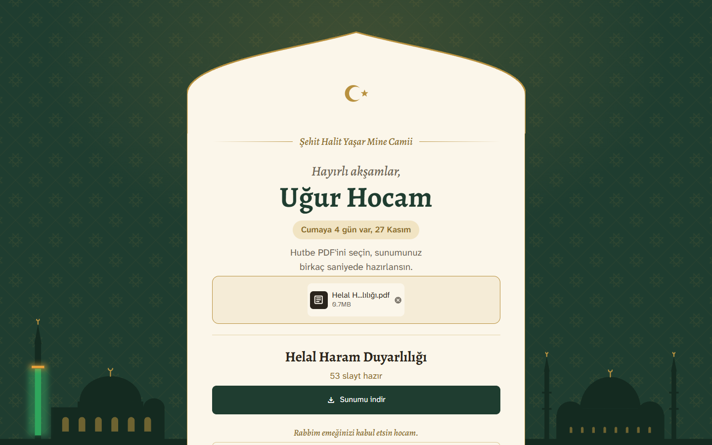
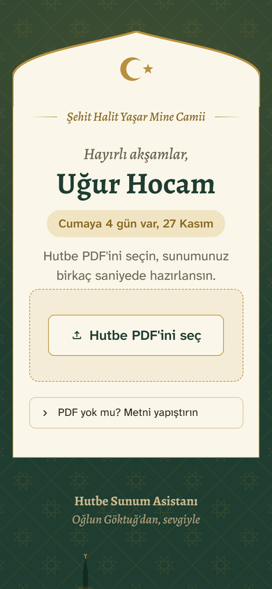

# 🕌 Hutbe Sunum Asistanı

<p align="center">
  
  &nbsp;
  
</p>

Hutbe Sunum Asistanı, Diyanet İşleri Başkanlığı tarafından yayımlanan cuma hutbelerini otomatik olarak PowerPoint sunumuna dönüştüren bir uygulamadır.

Hutbe metni elle kopyalanıp slaytlara yerleştirilmez. Kullanıcı hutbe PDF'ini seçer, sunum birkaç saniyede hazırlanır ve indirilir. Uygulama tarayıcıdan çalıştığı için bilgisayardan da telefondan da kullanılabilir, herhangi bir kurulum gerektirmez.

---

## 🚀 Özellikler

### Sunum oluşturma
- 📄 Diyanet hutbe PDF'lerini otomatik okur.
- 📑 İki sütunlu PDF yapısını doğru işler.
- 🧹 Arapça metinleri, dipnotları ve tek başına kalan noktalama işaretlerini temizler.
- ✂️ Metni cümlelere ayırır, her cümleyi ayrı slayta yerleştirir.
- 🕌 Giriş ve kapanış görsellerini sunuma ekler.
- 📅 Giriş slaytına o haftanın Cuma tarihini yazar (Türkiye saatine göre).
- 📝 PDF yoksa yapıştırılan metinden de sunum oluşturur.

### Web arayüzü
- 🌐 Tarayıcıdan çalışır, kurulum gerektirmez. Telefon ve bilgisayar uyumludur.
- ⚡ PDF seçildiği anda sunum hazırlanır, tek tıkla indirilir.
- 🔎 Hazırlanan hutbenin başlığını ve slayt sayısını gösterir.
- 🗓️ Güne ve saate göre selam ile Cuma'ya kalan gün sayacı içerir.
- 🎨 Mihrap şeklinde pano, İslami geometrik desen ve cami silüetlerinden oluşan özel bir tasarıma sahiptir. Silüetteki yeşil minareli cami, Şehit Halit Yaşar Mine Camii'dir.
- 🔄 GitHub'a gönderilen her değişiklik siteye otomatik olarak yansır.

---

## 🛠️ Kullanılan Teknolojiler

- Python
- Streamlit (web arayüzü)
- Streamlit Community Cloud (ücretsiz barındırma)
- pdfplumber
- python-pptx
- Pillow
- Tkinter ve PyInstaller (eski masaüstü sürümü)

---

## 📂 Proje Yapısı

```text
HutbeSunumAsistani/
│
├── app.py                  # Web arayüzü (Streamlit)
├── pdf_oku.py              # PDF'ten hutbe metnini okuma
├── ppt_olustur.py          # Metni PowerPoint sunumuna dönüştürme
├── ayarlar.py
│
├── arayuz.py               # Eski masaüstü arayüzü (Tkinter)
├── main.py
│
├── hutbe_sablonu.pptx
├── giris_gorselleri/       # Sunumun başına eklenen görseller
├── cikis_gorselleri/       # Sunumun sonuna eklenen görseller
│
├── .streamlit/config.toml  # Tema ve sunucu ayarları
├── requirements.txt
├── README.md
└── hutbe.ico
```

---

## 🚀 Kullanım

### İnternetten
1. Uygulamanın web adresine girin.
2. **Hutbe PDF'ini seç** butonuna tıklayıp Diyanet hutbe PDF'ini seçin.
3. Sunum hazırlanınca **Sunumu indir** butonuna tıklayın.

> Site bir süre kullanılmazsa uyku moduna geçer. Açılışta "uyandır" butonu çıkarsa tıklayıp yarım dakika kadar bekleyin.

### Kendi bilgisayarınızda
```bash
pip install -r requirements.txt
python -m streamlit run app.py
```
Ardından tarayıcıda http://localhost:8501 adresi açılır.

---

## 💡 Projenin Hikâyesi

Bu proje, babamın her hafta cuma hutbesini PowerPoint sunumuna elle hazırlamak için harcadığı zamanı azaltmak amacıyla geliştirildi.

İlk sürüm bir Windows masaüstü uygulamasıydı. Ancak her düzeltmede yeni bir exe dosyası hazırlayıp babama ulaştırmam gerekiyordu, bir sorun çıktığında uzaktan müdahale edemiyordum. Bu yüzden uygulama, ücretsiz olarak barındırılan bir web uygulamasına dönüştürüldü. Artık yapılan her düzeltme birkaç dakika içinde doğrudan babamın kullandığı siteye yansıyor.

---

## 🔮 Gelecek Planları

- Farklı sunum şablonları
- Çoklu dil desteği

---

## 👨‍💻 Geliştirici

**Göktuğ Kocatürk**

- GitHub: https://github.com/goktug01-dev
- LinkedIn: https://www.linkedin.com/in/g%C3%B6ktu%C4%9F-kocat%C3%BCrk-b8290b380/
